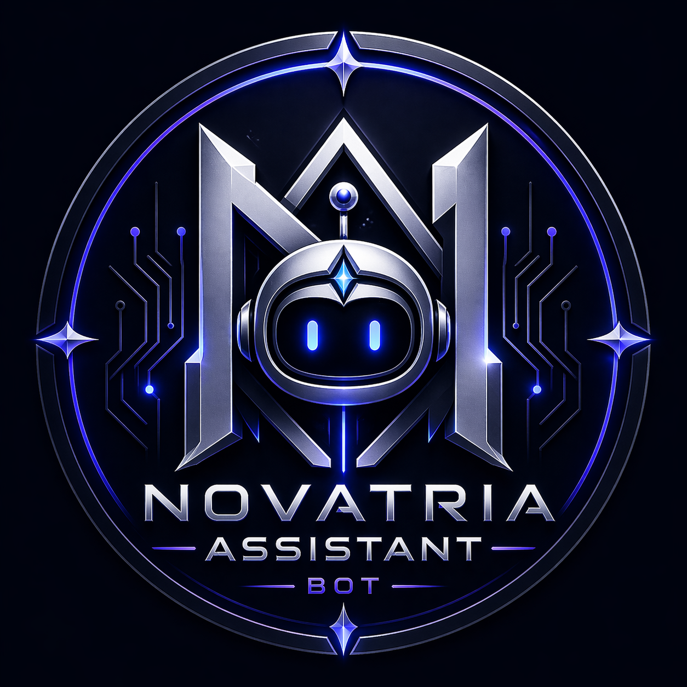

<p align="center">
  
</p>

# Novatria Assistant Bot (v2.0.0)

[](https://nodejs.org/)
[](https://discord.js.org/)
[](https://github.com/WiseLibs/better-sqlite3)
[](LICENSE)

**Novatria Assistant Bot v2.0.0** adalah bot Discord ultra-ringan, cepat, dan aman yang dirancang untuk kebutuhan server komunitas, gaming, pembagian akun/API gratis (bansos), serta manajemen remote host VPS Hermes langsung dari Discord.

---

## ⚡ Fitur Utama

### 👑 1. Remote Controller Hermes VPS & AI Chat (Admin Only)
Kelola daemon Hermes, ajak chat AI, dan pantau server VPS langsung dari Discord:
* **Direct AI Chat (`#hermes-chat`)**: Mengobrol langsung dengan Hermes Autonomous Agent dengan memori percakapan multi-turn, typing indicator, dan auto-splitter.
* `/hermes status` — Melihat status daemon Hermes (`active`/`inactive`), sistem operasi, uptime VPS, dan kapasitas memori RAM yang terpakai.
* `/hermes cmd <command>` — Menjalankan perintah terminal/shell di VPS secara aman dengan timeout 10 detik dan pemotongan output otomatis jika melebihi batas pesan Discord.
* `/hermes restart` — Mengirim instruksi restart service daemon Hermes ke `systemd`.
* `/hermes backup` — Membuat snapshot instan database SQLite (`database.sqlite`) dan mengunggahnya ke channel admin.
* `/hermes mode <persona>` — Mengubah persona AI Hermes secara instan:
  * ⚡ **Unrestricted Agent** (Default autonomous mode)
  * 🧑‍💻 **Senior Full-Stack Engineer** (Fokus arsitektur & coding)
  * 🛡️ **Offensive Security & Pentester** (Audit keamanan & exploit analysis)
  * 📚 **Deep Technical Researcher** (Sintesis data & riset mendalam)

### 🎁 2. Sistem Bansos Akun & API Key Otomatis
Distribusi akun premium dan API key gratis secara instan, aman, dan anti-rebutan:
* `/bansos add <tipe> <label> <konten>` — Menambahkan stok akun (Canva, Spotify, VPN) atau API Key (OpenAI, DeepSeek, Groq) ke database SQLite (Admin).
* `/bansos stock` — Menampilkan ringkasan sisa stok yang tersedia vs yang sudah diklaim.
* `/bansos history [user] [limit]` — Menampilkan audit riwayat klaim member lengkap dengan timestamp dan credential (Admin).
* `/bansos drop <tipe> [channel]` — Mengirim panel embed interaktif berisi tombol klaim langsung ke channel publik:
  * `[🎁 Klaim Akun Gratis]`
  * `[🔑 Klaim API Key]`
* **Fitur Keamanan & Notifikasi Bansos:**
  * **Auto-Moderasi Anti-Scam**: Otomatis mendeteksi dan menghapus link fake nitro, phishing, dan invite server ilegal di channel publik.
  * **Auto-Backup 24 Jam**: Setiap 24 jam bot secara otomatis mengunggah backup `database.sqlite` ke channel `#bansos-manage`.
  * **Anti-Raid / Akun Baru Guard**: Memverifikasi umur akun Discord (minimal 3 hari secara default); akun baru/bot ditolak otomatis.
  * **Notifikasi Feed Otomatis**: Otomatis mengirim pemberitahuan mention `@Bansos Hunter` di `#bansos-feed` setiap ada drop baru.
  * **Atomik SQLite (`better-sqlite3`)**: Menggunakan database transaksi ACID tunggal; mencegah *race condition* atau duplikasi klaim meskipun ratusan user mengklik tombol bersamaan.
  * **Pesan Rahasia (Ephemeral)**: Detail login akun / string API key hanya dikirimkan ke pengguna yang mengklik tombol dan tidak terlihat oleh orang lain di channel.
  * **Anti-Timbun**: Pembatasan 1 kali klaim per pengguna per kategori.
  * **Log Real-time**: Rekap klaim otomatis dikirim ke channel log admin (`#bansos-manage`).

### 🌟 3. Komunitas, Gaming & Support Desk
* **Interactive Mabar Coordinator (`/mabar`)**: Membuat ajakan main game favorit dengan slot interaktif (contoh: 2/5 pemain), tombol `[🟢 Ikut Mabar]` / `[🔴 Batal]`, dan live-update player list.
* **In-House Support Ticket (`/ticket panel`)**: Tombol `[📩 Buka Tiket Bantuan]` yang membuat private channel otomatis untuk member berkonsultasi langsung dengan Admin, dilengkapi tombol `[🔒 Tutup Tiket]`.
* **Welcome Card Bergambar Otomatis**: Menyambut member baru di channel `#welcome` dengan kartu grafis selamat datang (PNG 800x360) berisi avatar member, nama, dan nomor urut member server.
* **Dynamic Server Stats (`/stats setup` & `/stats sync`)**: Counter member otomatis real-time di channel voice terkunci paling atas server.
* **Auto-Role & Self-Role (`/rolepanel`)**: Auto-role `Member` dan self-role `Bansos Hunter` / `Gamers`.

---

## 📁 Struktur Kategori & Channel Server Discord

Untuk pengalaman terbaik, susun channel Discord Anda sebagai berikut:

```text
📁 📌 WELCOME & RULES (Public, Read-Only)
   ├── 💬 #welcome          <-- Pesan sambutan otomatis & avatar member
   ├── 💬 #rules            <-- Peraturan & pedoman komunitas
   └── 💬 #ambil-role       <-- Panel tombol self-role (/rolepanel)

📁 💬 CHILL ZONE (Public)
   ├── 💬 #general-chat     <-- Tempat ngobrol santai antar member
   ├── 💬 #media-meme       <-- Share gambar, video, dan meme
   └── 🔊 Chill Lounge      <-- Voice channel santai

📁 🎯 MABAR & GAMING (Public)
   ├── 💬 #ajak-mabar       <-- Channel teks koordinasi & janjian game
   ├── 🔊 Mabar Room 1      <-- Voice channel gaming 1
   └── 🔊 Mabar Room 2      <-- Voice channel gaming 2

📁 🎉 BANSOS CORNER (Public, Read-Only)
   ├── 💬 #bagi-akun        <-- Panel embed klaim akun gratis
   └── 💬 #bagi-api         <-- Panel embed klaim API key gratis

📁 🔒 ADMIN & HERMES (Private, Admin Only)
   ├── 💬 #hermes-control   <-- Remote control Hermes & VPS (/hermes)
   └── 💬 #bansos-manage    <-- Input stok bansos & notifikasi klaim
```

---

## 🚀 Panduan Deployment

### Cara 1: Menggunakan Docker & Docker Compose (Direkomendasikan di VPS)

1. **Clone repository dan siapkan konfigurasi:**
   ```bash
   cp .env.example .env
   nano .env
   ```
   Isi konfigurasi sesuai channel & role ID server Discord Anda.

2. **Jalankan container:**
   ```bash
   docker compose up -d --build
   ```

3. **Cek status & log:**
   ```bash
   docker compose logs -f
   ```

*Data SQLite tersimpan persisten di folder `./data` di host VPS.*

---

### Cara 2: Menjalankan Langsung dengan Node.js

1. **Pastikan Node.js v20+ sudah terinstal.**
2. **Install dependensi:**
   ```bash
   npm install
   ```
3. **Isi file `.env`:**
   ```bash
   cp .env.example .env
   ```
4. **Jalankan bot:**
   ```bash
   npm start
   ```

---

## ⚙️ Variabel Konfigurasi (`.env`)

| Variabel | Keterangan |
|---|---|
| `TOKEN` | Token Bot dari Discord Developer Portal |
| `CLIENT_ID` | Application ID Bot |
| `GUILD_ID` | ID Server Discord (agar slash command instan terdaftar) |
| `ADMIN_CHANNEL_ID` | ID Channel `#hermes-control` |
| `BANSOS_LOG_CHANNEL_ID` | ID Channel `#bansos-manage` |
| `WELCOME_CHANNEL_ID` | ID Channel `#welcome` |
| `BANSOS_CHANNEL_ID` | ID Channel `#bagi-akun` |
| `DEFAULT_ROLE_ID` | Role ID default yang diberikan ke member baru |
| `ROLE_BANSOS_ID` | Role ID untuk Bansos Hunter |
| `ROLE_GAMERS_ID` | Role ID untuk Gamers / Mabar |
| `ADMIN_ROLE_IDS` | Role ID admin yang berwenang (pisahkan koma jika >1) |
| `HERMES_SERVICE_NAME` | Nama systemd service Hermes di VPS (default: `hermes`) |

---

## 🧪 Pengujian Otomatis (Unit & Integration Tests)

Jalankan rangkaian pengujian bawaan tanpa library pihak ketiga tambahan:
```bash
npm test
```

Semua pengujian memverifikasi integritas database SQLite, alur klaim bansos, permission guard, dan service Hermes.
